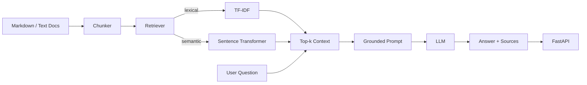

# ML2++ RAG Copilot

[Portfolio index](../README.md) · [All projects](../../PROJECTS.md)

Run the commands below from `portfolio/ml2pp-rag-copilot` inside the repository. From the repository root:

```bash
cd portfolio/ml2pp-rag-copilot
```

A portfolio-ready **LLM + Retrieval-Augmented Generation (RAG)** service grounded in time-series forecasting and ML2++ documentation.

The goal is to demonstrate practical skills that are frequently requested in AI/ML engineering roles:

- document ingestion and chunking
- lexical and semantic retrieval
- embeddings and top-k similarity search
- grounded prompting with source citations
- OpenAI Responses API integration
- FastAPI service design
- Docker packaging
- automated tests
- RAG evaluation ideas and production extensions

## Why this project

This project connects LLM/RAG engineering to a real domain: **time-series forecasting for IoT/CPS**. Instead of building a generic chatbot, it answers questions such as:

- Why should time-series data be split chronologically?
- What is data leakage in forecasting?
- How do lag and forecast horizon affect a forecasting pipeline?
- When would XGBoost be preferable to an LSTM?
- What does ML2++ automate?

## Architecture



## Run locally

```bash
python -m venv .venv
source .venv/bin/activate
pip install -r requirements.txt
cp .env.example .env

uvicorn app.main:app --reload
```

Open:

- `GET /health`
- `POST /retrieve`
- `POST /ask`

Example:

```bash
curl -X POST http://127.0.0.1:8000/ask \
  -H "Content-Type: application/json" \
  -d '{"question":"Why is random train-test splitting risky in time-series forecasting?","top_k":3}'
```

The app works in **retrieval-only mode** without an API key. Add `OPENAI_API_KEY` to `.env` to generate a grounded LLM answer.

## Semantic retrieval

Default mode is lightweight TF-IDF so tests run quickly.

To use local embeddings, install the optional semantic dependency first:

```bash
pip install -r requirements-semantic.txt
export RETRIEVER_BACKEND=semantic
uvicorn app.main:app --reload
```

The semantic backend uses a Sentence Transformer and cosine similarity.

## Docker

```bash
docker build -t ml2pp-rag-copilot .
docker run --rm -p 8000:8000 \
  -e OPENAI_API_KEY="$OPENAI_API_KEY" \
  ml2pp-rag-copilot
```

## What to explain in an interview

### 1. RAG
RAG retrieves relevant external knowledge before generation. This reduces hallucination and makes the answer traceable to source documents.

### 2. Chunking
Large documents are split into overlapping chunks. Chunk size is a trade-off: very small chunks lose context; very large chunks reduce retrieval precision.

### 3. Embeddings
Semantic retrieval maps text to vectors. Similar questions and passages should be close in vector space even when they do not share identical words.

### 4. Top-k retrieval
The retriever returns the k most relevant chunks. Increasing k can improve recall but may add noise.

### 5. Grounding
The LLM receives only the retrieved context plus instructions to avoid unsupported claims and return source names.

### 6. Evaluation
A production RAG system should evaluate:
- retrieval recall / precision
- answer relevance
- faithfulness / groundedness
- citation correctness
- latency and cost

## RAG evaluation

The repository includes a reviewed evaluation set and scripts under `evaluation/`.

Run retrieval evaluation:

```bash
PYTHONPATH=. python -m evaluation.evaluate_retrieval --backend lexical --k 3
```

Reported metrics include:

- Hit Rate@K
- Precision@K
- Recall@K
- MRR
- average and P95 retrieval latency

Generated-answer evaluation is kept separate and includes citation correctness,
keyword coverage, and a lightweight unsupported-number hallucination check.
For production use, extend this with semantic faithfulness / groundedness and
answer-relevance judging.

See [`evaluation/README.md`](evaluation/README.md).

## Production extensions

Good next steps for an industry version:

- persistent vector database such as pgvector, Qdrant, or Pinecone
- hybrid BM25 + dense retrieval
- reranking
- authentication and rate limiting
- async ingestion pipeline
- OpenTelemetry / tracing
- prompt and model versioning
- offline RAG evaluation set
- feedback loop
- Kubernetes deployment
- CI/CD

## Interview positioning

Use this repository when discussing:

- LLM engineering
- RAG
- embeddings and vector search
- FastAPI / REST APIs
- Docker
- AI system design
- grounded generation
- ML/LLM evaluation

**Project owner:** Zahra Mardani Korani


<!-- BEGIN FOLDER GUIDE -->
## Folder guide

The document-retrieval API, optional generated answers, sample documents, evaluation scripts and tests.

[Parent folder](../) · [Repository overview](../../README.md) · [All projects](https://github.com/zahramardani/ML2PP-Artifacts/blob/main/PROJECTS.md)

### Contents

| Item | What it is |
|---|---|
| [app/](app/) | The FastAPI endpoints and document-loading, chunking, retrieval and prompt-building implementation. |
| [data/](data/) | The local document collection supplied for the retrieval demonstration. |
| [evaluation/](evaluation/) | The existing evaluation questions and scripts for retrieval and generated-answer checks. |
| [tests/](tests/) | Tests for document retrieval, chunking and evaluation helpers. |
| [.env.example](.env.example) | Example environment-variable configuration. |
| [.gitignore](.gitignore) | Patterns excluding local caches, environments or generated outputs from new commits. |
| [Dockerfile](Dockerfile) | Container-image build instructions for this application. |
| [INTERVIEW_NOTES_FA.md](INTERVIEW_NOTES_FA.md) | Persian explanation notes supplied with the portfolio example. |
| [requirements-semantic.txt](requirements-semantic.txt) | Optional dependencies for semantic retrieval. |
| [requirements.txt](requirements.txt) | Python dependency list for this component. |

**Start here:** [app/](app/).

<!-- END FOLDER GUIDE -->
